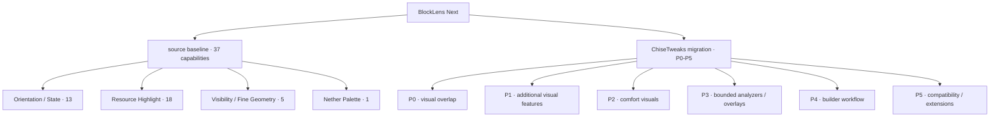
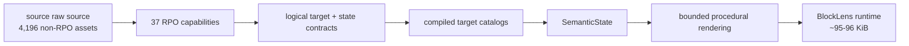
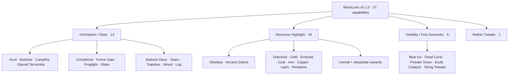
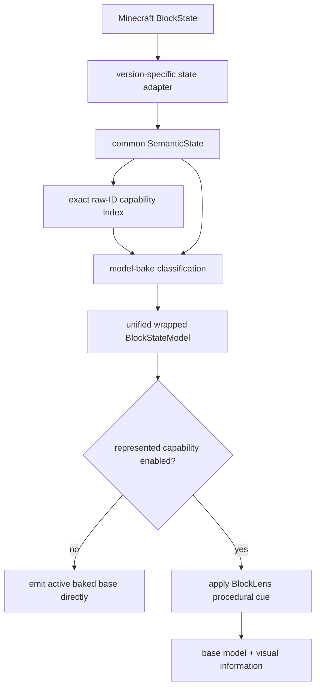
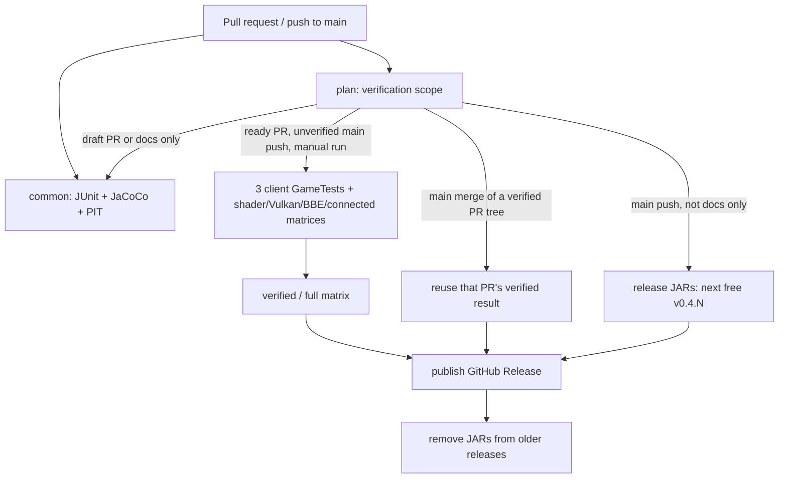
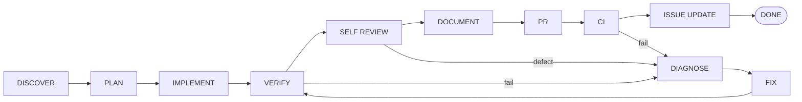

# BlockLens

Clean-room glowing ore edges use a generated six-face, translucent-border overlay for the 18 supported vanilla ores, following each ore's existing independent highlight switch. The original third-party art/OptiFine CTM tiles are not redistributed. A separate default-off **Connected ore borders** control removes shared seams between compatible fixed cube models. Unsupported model shapes keep independent borders; see the [native connection contract](knowledge/current/native-connected-ore-plan.md). Every enabled model uses precompiled immutable face instructions; neither startup nor a chunk render scans ZIP files.

<p align="center">
  
</p>

**English** | [日本語](README_ja.md)

BlockLens is a **client-side visual inspection mod for Minecraft Java Edition**. It makes block orientation and state, resources, fine geometry and Nether materials easier to distinguish through 61 independently configurable visual and inspection capabilities. See the [complete current feature list](knowledge/current/features.md).

Orientation controls draw clean-room decals over the active texture: glazed terracotta shows an arrow on all six faces, logs/wood/froglights show axis-colored rails and frames, and slabs mark the same faces as the original pack. See [pack information parity](knowledge/current/pack-information-parity.md).

The core design goal is **source/function parity, not byte-for-byte asset bundling**. If a set of raw blockstate/model/texture files describes one logical visual capability, BlockLens represents that behavior as compiled target catalogs, semantic state, and bounded procedural rendering.

> **Current implementation:** BlockLens **v0.4.7** provides **61 independently configurable capabilities** for Minecraft **26.1.2**, **26.2**, and **26.3**, including world analyzers, scene filters, builder assist, ore extensions, and optional Mod Menu / Sodium integration.
>
> **Historical releases:** BlockLens **v0.1.0** remains the immutable 37-capability source release baseline. P0 shipped in v0.2.0 with **328 capability-to-target bindings / 322 unique block targets** under its historical **100 KiB** budget; v0.2.2 added the Mod Menu entrypoint. Current policy uses a user-authorized **200 KiB / 204,800 B** ceiling for development and release artifacts.

Resources also provides **All OFF** (all 22 Resource controls) and **Obsidian pair ON** (Obsidian and Crying Obsidian only; other settings stay intact). These shortcuts edit the draft; use Apply to save and reflect them.

> **Current catalog:** 61 independent capabilities. Published downloads are listed on [GitHub Releases](https://github.com/bosatsu25/BlockLens/releases). The ancient-debris analyzer and optional Masa/Litematica schematic comparison are retired; the original 37 source controls remain intact. The published v0.3.0 artifact is unchanged.


The default-off **Neutral pale oak** control recolors vanilla wood while preserving grain and colored hardware. Saving a change reloads textures; external pack textures take priority. Three modern sign aliases cover 26.2/26.3. See [the palette contract](knowledge/current/native-pack-palette-plan.md).

## Native profiles from the six supplied resource packs

BlockLens now offers source-informed presets without redistributing image/model/font assets: **Glow ores** (19 independent vanilla ore highlight toggles), **Small Handhelds-style** (40/40/50 percent first-person blocks/items/tools), and **Eater Clear** (registered IDs from the 196 original full-clear model overrides, through the existing Block Filter). The existing Low Fire, Bright Concrete and Bright Chest capabilities remain available. Presets edit the existing draft only; enable the related capability when needed, then **Apply** or **Save and close**.

The original OptiFine connected-texture border art, the original lowered fire sprites and Chise's pale-oak artwork are **not** reproduced inside the JAR. Physical collision and solid occlusion remain unchanged. See the [source-by-source audit and scope limitations](knowledge/current/resourcepack-native-profiles.md).

The default-off **Simplified terrain** control gives bounded vanilla terrain an opaque dark-gray style and sparse grass/bush masks. Existing dripleaf, vine, dripstone and leaf-litter states retain their geometry. External resource definitions take priority; world state, collision and solid occlusion remain unchanged. See [the implementation and verification plan](knowledge/current/native-simplified-terrain-plan.md).

## Three Minecraft versions and visible UI tests

Published v0.4.1 fixes closed regular chest brightening on Minecraft 26.3 with exact BBE 1.3.9+mc26.3 and Sodium 0.9.2+mc26.3. BBE optimization remains enabled; trapped/ender/copper/Christmas materials are not substituted. The tested Cele stack adds Iris 1.11.7+mc26.3 and Continuity 3.0.1+26.3 with shaders OFF. BBE plus shaders ON is unverified. Upgrade with one matching BlockLens JAR and retain configuration. Publishing requires the same commit's normal, shader/backend and BBE/Cele matrices; see [the precise compatibility boundary](knowledge/current/cele-bbe-compatibility.md).

The current build targets **26.1.2 / 26.2 / 26.3** with 61 independent capabilities and preserves the original 37-control baseline. Visual controls, four bounded analyzers, two independent scene filters and three advisory Builder Assist tools share the settings workflow. Java 25, Fabric Loader **0.19.5+** and the matching Fabric API are required. PR #40's native settings redesign is merged. Current-head three-version validation is required; published v0.4.0 already supports all three targets.

To watch real Minecraft UI automation on Windows, with Java 25 and Gradle 9.5.1 on PATH, run `./scripts/run-ui-tests.ps1` (all three) or `./scripts/run-ui-tests.ps1 -Version 26.3`. The runner opens actual clients sequentially using the built distribution JAR, checks loaded class origins, exits after testing and stops on failure. CI requires ten settings screenshots per target and separate rendering/JAR evidence. See [current version contract, exact dependencies and verification status](knowledge/current/minecraft-26-3.md).

The four analyzers find qualifying loaded source lava, outline beacon/rod ranges, and link actual client villager job-site memories. They default OFF and share numeric radius/marker/interval settings and the existing save/discard draft. Unloaded chunks are skipped, dense scans take multiple ticks, and unavailable villager memory never produces an inferred workstation. See [work limits and exact behavior](knowledge/current/world-analyzers.md).

The two scene filters independently edit block/entity type ID blacklists and whitelists. They default OFF, retain the local player, and preserve fluids, physical state and solid occlusion. List edits share the parent save/discard draft. See [the filter contract and verification](knowledge/current/scene-filter.md).

## Builder Assist and ore extensions

Enable the three independent Builder Assist tools in Other, then **Apply** or **Save and close**.
In a world, open the panel using an Open button on those rows, or assign the initially
unbound Builder Assist key. It displays local crosshair state, predicts supported
main-hand block placement, and compares nearby blocks with an explicit session reference.
These tools inspect and explain; they never place or break blocks or send custom packets.

No Masa-family mod is required or integrated. See [Builder Assist](knowledge/current/builder-assist.md).

[The ore extension contract](knowledge/current/extension-compatibility.md) accepts
explicit versioned registrations and a fixed set of synchronized conventional ore tags.
It reuses the existing Resource controls and active base models, with bounded retained
terrain models and no per-frame registry scan. Supported renderer/evidence boundaries,
including the exact Shader and Vulkan test matrix, are listed in
[external compatibility](knowledge/current/external-compatibility.md).

Ore extensions and terrain block filtering also have an
[optional Sodium adapter](knowledge/current/sodium-terrain-compatibility.md) for
**0.9.2+mc26.1.2 / 0.9.2+mc26.2 / 0.9.2+mc26.3**, matched to the corresponding
Minecraft version. Other versions skip this adapter. Dedicated native ore/filter
probes supplement the pinned M3/M5 shader tests; the evidence covers these named
paths and does not establish blanket compatibility for all 61 capabilities under arbitrary shaders.

## Product direction

BlockLens is the product base. ChiseTweaks is a source of selected capabilities and design ideas; it is **not** a runtime dependency.



Delivered P0 is recorded in closed **Issue #22**. Remaining migration is tracked in **#42 and #34-#38** and [`knowledge/current/chisetweaks-migration.md`](knowledge/current/chisetweaks-migration.md).

## Source raw-source parity

The original intent is preserved: **all useful behavior represented by the effective source raw source must be represented by BlockLens**. That does not mean copying every source file into the runtime JAR.

The latest raw-source audit reproduced the established M0 evidence shape:

- **37 distinct RPO condition keys**
- **337 `.rpo` sidecars** in the supplied archive
- **336 effective gated roots**
- the 337th sidecar is an orphan duplicate `pale_oak_slab.rpo`, not a 38th capability
- **4,196 non-RPO Minecraft assets**
- **4,101 reachable assets** from effective RPO-gated roots
- **95 unreachable/source-residue candidates**
- BlockLens v0.1.0: **37 compiled capabilities / 323 capability-to-target bindings**

The raw source is therefore compressed into logical behavior rather than embedded literally:



### Source-to-runtime grouping

| Source group | RPO keys | Effective source shape | BlockLens v0.1.0 logical coverage |
| --- | ---: | --- | --- |
| Orientation / Decoration | 13 | blockstates + large model/texture dependency graph | **254 block targets** |
| Resource Highlight | 18 | 18 independently gated resource roots | **18 block targets** |
| Outline / Visibility | 4 | texture/blockstate gates | Blue Ice + **20 Dead Coral forms** + Powder Snow + Sculk Catalyst |
| String Tweaks | 1 | Tripwire blockstate + dependent geometry | **Tripwire** |
| Nether Tweaks | 1 | **33 textures + 1 model** | **27 Nether block targets** |

Two cases are worth calling out:

- **Dead Coral:** 15 gated textures represent 20 logical dead-coral block forms because wall-fan forms reuse fan textures. BlockLens targets all 20 logical forms.
- **Nether Tweaks:** 33 gated textures plus one Magma Block model represent 27 logical block targets. BlockLens targets those 27 blocks rather than shipping the original texture set.

The complete per-capability audit is in [`knowledge/current/source-raw-parity-audit.md`](knowledge/current/source-raw-parity-audit.md) and tracked by **Issue #24**.

## Stable v0.1.0 capability map



The supplied RPO preset historically enables five capabilities by default: Blue Ice, Dead Coral, Powder Snow, Sculk Catalyst, and String Tweaks. That preset is not the complete product scope.

## P0: ChiseTweaks visual-overlap absorption

P0 extends the existing BlockLens engine rather than importing the ChiseTweaks feature framework.

### Additive capabilities

- Crying Obsidian
- Nether Gold Ore
- Nether Quartz Ore

### Existing capabilities extended with ChiseTweaks parity

- String Tweaks → adds **Tripwire Hook** coverage
- Nether Tweaks → adds **Polished Basalt** coverage

P0 preserved the first 37 enum entries, bit positions, source/config keys and historical defaults. Current keys/bits and explicitly saved values remain stable; v0.4.6 deliberately defaults Visibility OFF for new or missing settings.

Published v0.2.0 contract:

- **40 capabilities**
- **328 capability-to-target bindings**
- **322 unique block targets**
- published JAR: **96,248 B** on both Minecraft lines
- release-era cross-platform no-growth baseline: **96,257 B**
- release ceiling: **102,400 B / 100 KiB**, unchanged

P0 was merged in PR #23 at `b440d43904e2a93236549efc571b7cc127622352`. Main CI **#270 / `34801429999`** and Release **#31 / `34802548055`** completed successfully before v0.2.0 was published.

## Runtime architecture



Runtime principles:

- compiled catalogs; no reflection/classpath feature discovery
- no whole-world target scan for ordinary visual features
- no per-frame registry scan
- semantic interpretation at model bake
- primitive enabled-capability mask on the render hot path
- direct active-base emission when represented capabilities are OFF
- immutable/bounded cue and instruction reuse
- bounded retained-capability structure across repeated resource reloads
- client-only packaging with no nested runtime dependency JARs

### Current source hardening

The current source tree provides a native **B-key settings screen** and an optional **Mod Menu** entrypoint without a required UI dependency. Its category-based redesign groups all 61 options into **Decoration, Resources, Visibility, and Other**, with explanations and separate Enabled/Disabled controls. **Apply** saves and installs edits while keeping the screen open; **Save and close** also returns to the parent. **Discard** and **Esc** discard edits since the last successful apply. New settings default all nine Visibility controls to OFF; existing saved values are preserved. See [settings UI behavior and verification boundaries](knowledge/current/settings-ui.md). The redesign is merged in PR #40. Private six-pack resource priority in both orders and three rendered controls pass on all targets. Other pack-specific combinations and source-screen pixel equivalence remain unverified; exact Shader and Vulkan results are tracked in [the delivery record](knowledge/current/remaining-delivery.md).

Bounded config reads, synchronous temporary-file writes with atomic replacement where supported, immutable config publication, safe lazy-overlay publication, cached semantic enum tables/instructions, and two retained descriptor arrays per wrapped model are implemented. Historical v0.2.1 local artifacts measured **101,877 B / 101,913 B** under the then-current **102,400 B** ceiling. Current three-version gates use the reviewed **204,800 B** development baseline and **204,800 B** release ceiling. OFF/default/all-capability M8 measurements remain coarse regression guards; observed CI allocation variability is tracked in [#43](https://github.com/bosatsu25/BlockLens/issues/43).

## Release

**v0.2.2** is a historical published stable release, at target `46ae5ccb1e60c92acd796acb0e2b10e740f9dcfc`.

| Minecraft | Published JAR | Size | SHA-256 |
| --- | --- | ---: | --- |
| 26.1.2 | `BlockLens-26.1.2-v0.2.2.jar` | **102,607 B** | `132312d74c1b160795a22a8dd1afa97c61eef3ced8b181c1b2eddc052f0a28e5` |
| 26.2 | `BlockLens-26.2-v0.2.2.jar` | **102,644 B** | `4e9dbf5bfb4971c7a30e8c69a37240b3637a35b0c25475e5cfdc584195e6f11f` |

The category-based settings redesign and three-version support are merged into main, with [all three real-client jobs verified](https://github.com/bosatsu25/BlockLens/actions/runs/38012153404). Published v0.4.0 includes all three targets; v0.4.1 is published; v0.4.2 adds the palette and v0.4.3 adds compact display; v0.4.4 develops independent terrain simplification. Each new release requires its own main CI and publication gates. Current development budgets are **204,800 B (200 KiB)** no-growth, **204,800 B (200 KiB)** release, and **1,183,432 B** absolute; headroom is not a growth target.

**v0.2.0** remains historical P0 release evidence.

| Minecraft | Published JAR | Size | SHA-256 |
| --- | --- | ---: | --- |
| 26.1.2 | `BlockLens-26.1.2-v0.2.0.jar` | **96,248 B** | `c678c4c5955596db0a1e3064bc1301ad44bb88b6141243e88ca1cefe9973e98a` |
| 26.2 | `BlockLens-26.2-v0.2.0.jar` | **96,248 B** | `54b99d9b66a403195e28850dcfb165083007ee6cddb3521c36176d51af031105` |

The release targets `b440d43904e2a93236549efc571b7cc127622352`. Successful main CI **#270 / `34801429999`** supplied the exact artifacts published by Release **#31 / `34802548055`**, together with `SHA256SUMS.txt`.

**v0.1.0** remains the historical 37-capability baseline.

| Minecraft | Published JAR | Size | SHA-256 |
| --- | --- | ---: | --- |
| 26.1.2 | `BlockLens-26.1.2-v0.1.0.jar` | **95,332 B** | `191f579fe7d574c94614b611c01420fa6887684e2fabc597966515490f59d24b` |
| 26.2 | `BlockLens-26.2-v0.1.0.jar` | **95,333 B** | `3848de8a07836d829d12ab5ed09ee650d5e1bebd4e0249b254436dda9c5a54be` |

The release was produced from successful `main` CI **#245 / `34768792311`** at commit `a4b63087004d687c3c8223d0d95c6c95fb2c5156`. Release run **#3 / `34769093202`** published the exact CI-verified JAR bytes plus `SHA256SUMS.txt`.

## Published v0.2.2 environment

| Item | Current verified contract |
| --- | --- |
| Minecraft | **26.1.2** and **26.2** |
| Loader | Fabric Loader **0.19.3+** |
| Fabric API | **0.155.2+26.1.2** / **0.160.0+26.2** |
| Java | **25+** |
| Side | **Client only** |
| Server-side BlockLens | Not required |
| Verified renderer path | default / **shader-OFF OpenGL** |
| Shader-ON | not yet claimed as supported |
| Minecraft 26.2 Vulkan | experimental |

Issue [#31](https://github.com/bosatsu25/BlockLens/issues/31) tracks the development shader/backend matrix and remaining third-party pack and renderer boundaries. Its results do not change the published v0.2.2 environment above. Core M5 Issue #5 is complete.

## Technology foundation

BlockLens is intentionally small at runtime, but its engineering and QA foundation is strict.

| Layer | Technology | Role |
| --- | --- | --- |
| Language | **Java 25** | production code, semantic engine, adapters, tests |
| Build | **Gradle 9.5.1** | multi-project build, deterministic artifacts, verification |
| Minecraft tooling | **Fabric Loom 1.17.19** | mappings, development runtime, build integration |
| Loader | **Fabric Loader 0.19.5** | current development client-side mod loading |
| Runtime API | **Fabric API** | Minecraft/Fabric hooks and Client GameTest integration |
| Unit / contract tests | **JUnit Jupiter 5.14.4** | semantic, config, target, repository and release contracts |
| Coverage | **JaCoCo 0.8.15** | line-coverage gate |
| Mutation testing | **PIT 1.19.0** | mutation coverage, score and test strength |
| PIT JUnit adapter | **pitest-junit5-plugin 1.2.3** | JUnit 5 mutation execution |
| Real-client integration | **Fabric Client GameTest** | real Minecraft startup/reload/render verification |
| Headless graphics | **Xvfb / Ubuntu 24.04** | framebuffer tests in GitHub Actions |
| CI/CD | **GitHub Actions** | three-version quality/release pipeline |
| Artifact integrity | **SHA-256** | reproducibility and CI/release byte identity |

Java compilation uses `-Xlint:deprecation`, `-Xlint:unchecked`, and **`-Werror`**.

Quality gates remain:

- JaCoCo line coverage: **>= 96%**
- PIT mutation coverage: **>= 96%**
- PIT mutation score: **>= 96%**
- PIT test strength: **>= 96%**

## Real-client verification

All three supported Minecraft versions run **Fabric Client GameTest** under Xvfb. The gate covers configuration round-trips, resource reload, Overworld/Nether transitions, target/state mapping, full enable/OFF restoration, rendered visual evidence, resource-pack preservation fixtures, M8 performance/retention observations, model resolution, and reproducible artifact checks.

The original 37-capability source baseline remains a historical regression contract even as the development runtime grows beyond it.

## Automated quality and release pipeline



Every merge to main that changes more than documentation publishes a release automatically. The version is the first free patch on the `mod_version` line in `gradle.properties` (for example v0.4.8 after v0.4.7); raise `mod_version` to start a new minor line. The release JARs are rebuilt from the verified tree with that version and pass the same packaging audit and size budgets; the deterministic build keeps their classes identical to the verified ones. When the merged tree equals a pull request head whose `verified / full matrix` check passed, the client matrices are not repeated. Draft and documentation-only pull requests run only the common gate; marking a draft ready starts the full matrix. Only the latest release keeps its JARs and `SHA256SUMS.txt`.

## Artifact size history

- M8 pre-icon baseline: **88,973 B**
- v0.1.0 icon-inclusive stable baseline: **95,333 B**
- P0 measured development maximum: **96,257 B**
- P0 growth over v0.1.0 baseline: **924 B maximum**
- historical v0.1.0 / P0 release budget: **100 KiB / 102,400 B**
- current reviewed development no-growth guard: **250 KiB / 256,000 B** (raised from 200 KiB on 2026-10-27)
- current product release ceiling: **250 KiB / 256,000 B**
- source-pack `<50%` absolute hard maximum remains unchanged

Size reduction is never allowed to remove functional parity, tests, compatibility evidence, or safety gates.

## Installation

For the stable release:

1. Install Fabric Loader for the target Minecraft version.
2. Install the matching Fabric API.
3. Use Java 25 or later.
4. Download the matching 26.1.2, 26.2, or 26.3 JAR from the [latest GitHub Release](https://github.com/bosatsu25/BlockLens/releases/latest).
5. Put the JAR in the Minecraft `mods` directory.
6. Launch the client.

BlockLens is client-only; server-side installation is not required.

## Build and verify

Install Gradle **9.5.1** on PATH and set JAVA_HOME to Java **25**. This repository does not contain a Gradle Wrapper.

```bash
gradle qualityGate
gradle ciGate
```

Per-version gates:

```bash
gradle :versions:mc26_1_2:build :versions:mc26_1_2:versionSmokeContract :versions:mc26_1_2:verifyRuntimeJarBudget
gradle :versions:mc26_2:build :versions:mc26_2:versionSmokeContract :versions:mc26_2:verifyRuntimeJarBudget
gradle :versions:mc26_3:build :versions:mc26_3:versionSmokeContract :versions:mc26_3:verifyRuntimeJarBudget
```

## Compatibility scope

Verified support is intentionally evidence-bounded:

- default / shader-OFF OpenGL: **verified**
- representative non-vanilla active resource-pack preservation: **verified fixture**
- arbitrary third-party resource packs: **not universally claimed**
- Iris/Sodium with Complementary Reimagined r5.9.3 LOW: **pinned three-version matrix and per-row evidence** in [external compatibility](knowledge/current/external-compatibility.md)
- Minecraft 26.2 / 26.3 Vulkan on the recorded Mesa software driver: **M3/M5 fixtures verified**; hardware-driver performance is outside this evidence
- Sodium ore extensions and terrain block filtering: **exact-version optional adapter**, with dedicated native emission/image controls in the six pinned Shader OFF/ON rows

The exact final development commit, full normal gate and public matrix results are recorded in
[the delivery record](knowledge/current/remaining-delivery.md) and linked PRs/issues. Uploaded private reference-pack verification is complete for Issue #31.

## Release / redistribution audit

The runtime JAR contains BlockLens code/resources and BlockLens-owned assets. CI rejects nested dependency JARs, local paths, logs, saves, crash dumps, secret/private-key markers, source RPO residue, and retired runtime-policy bytecode. Source PNG/JSON assets are not redistributed.

## Engineering Graph Loop



## Project documentation

- [`AGENTS.md`](AGENTS.md) — engineering rules
- [`knowledge/index.md`](knowledge/index.md) — knowledge index
- [`knowledge/current/product-spec.md`](knowledge/current/product-spec.md) — product contract
- [`knowledge/current/architecture.md`](knowledge/current/architecture.md) — architecture
- [`knowledge/current/source-raw-parity-audit.md`](knowledge/current/source-raw-parity-audit.md) — raw-source/RPO parity audit
- [`knowledge/current/chisetweaks-migration.md`](knowledge/current/chisetweaks-migration.md) — ChiseTweaks → BlockLens migration
- [`knowledge/current/quality-strategy.md`](knowledge/current/quality-strategy.md) — quality strategy
- [`knowledge/current/performance-strategy.md`](knowledge/current/performance-strategy.md) — performance strategy
- [`knowledge/current/m8-performance.md`](knowledge/current/m8-performance.md) — M8 evidence
- [`knowledge/current/release-readiness.md`](knowledge/current/release-readiness.md) — M9/release evidence
- [`knowledge/current/roadmap.md`](knowledge/current/roadmap.md) — roadmap
- [`knowledge/current/engineering-loop.md`](knowledge/current/engineering-loop.md) — Graph Loop

`knowledge/current/` is the source of truth. README claims remain bounded by verified evidence.

Additional development controls and their verification gates are documented in [lightweight visual and comfort features](knowledge/current/lightweight-visuals.md). The published v0.2.2 release continues to contain its original 40 capabilities.
